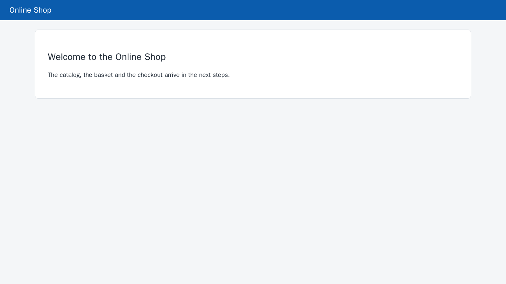
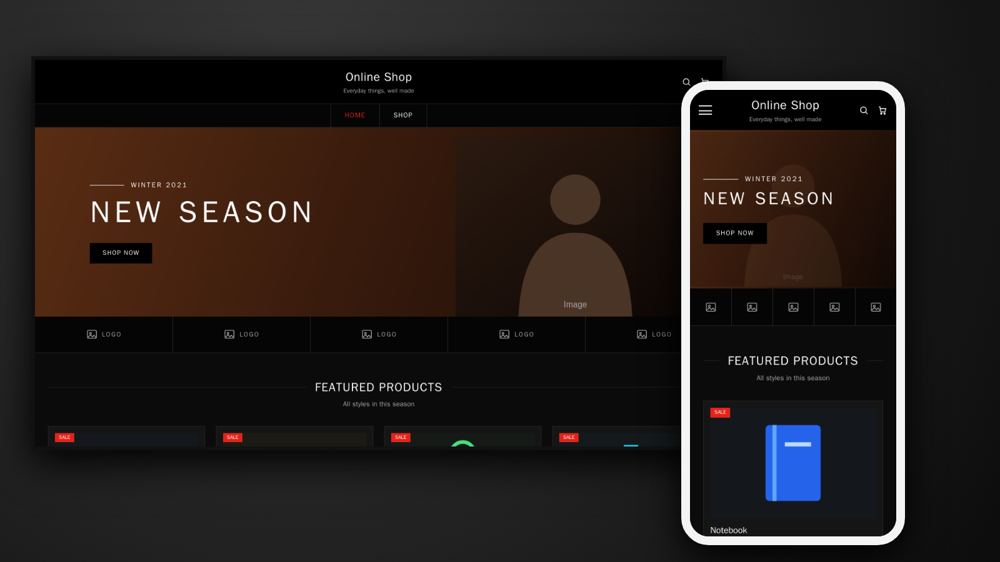
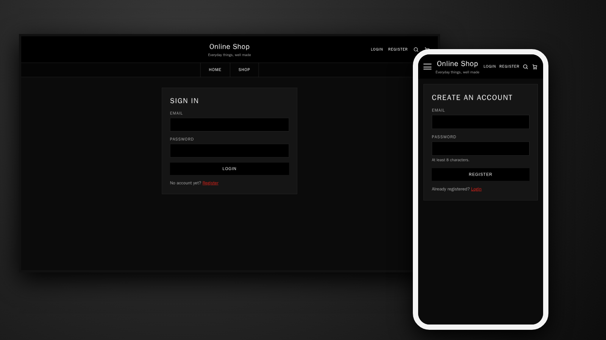
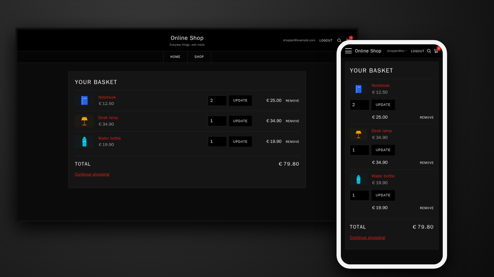
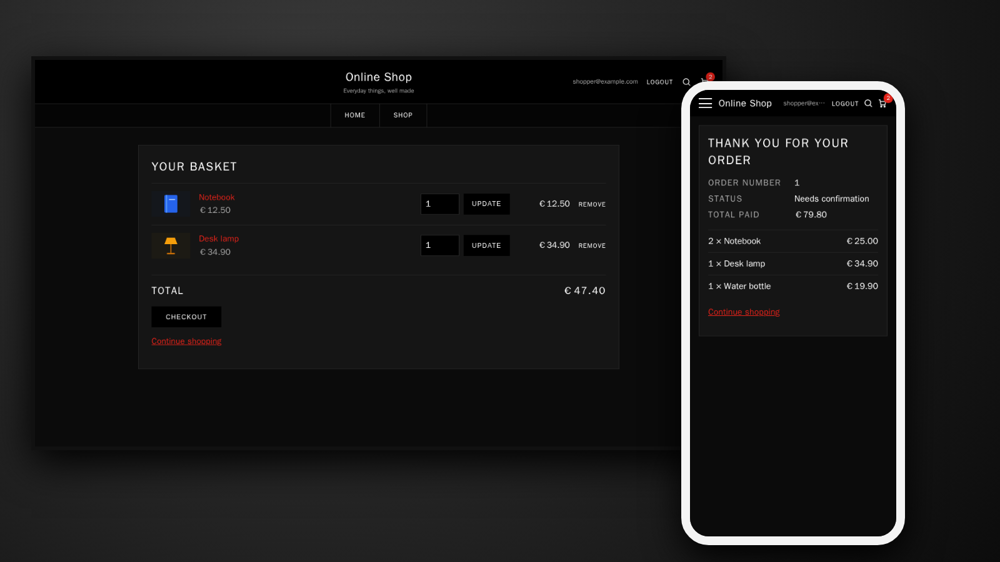
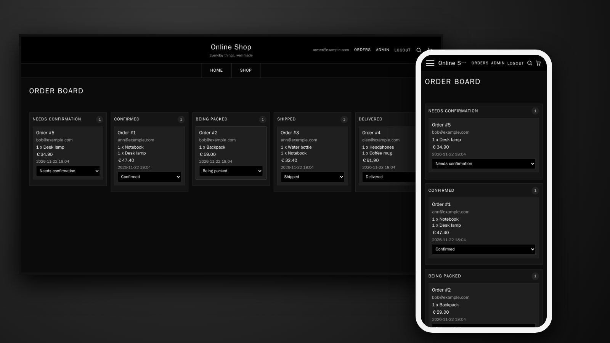

# 🚀 Online Shop

An online shop built with Flask, SQLite, Stripe Checkout and plain JavaScript, with Flask as the only direct runtime dependency. It is Day 97 of the 100 Days of Code bootcamp: products, a basket, registration and login, payment in a Stripe sandbox, and a Kanban board where the shop owner follows each order. It is for course participants who want to compare solutions and for visitors who look for ideas.

## 📚 Table of Contents

- [Overview](#-overview)
- [Requirements](#-requirements)
- [Setup](#-setup)
- [Run](#-run)
- [Screenshots](#-screenshots)
- [Tests](#-tests)
- [Reflection](#-reflection)
- [License](#-license)
- [Links](#-links)
- [Appendix: Project documents](#-appendix-project-documents)

## 🧭 Overview

Shoppers browse products, keep them in a basket, register, sign in and pay through Stripe Checkout (test mode). The shop owner signs in as admin and moves paid orders across a Kanban board: Needs confirmation, Confirmed, Being packed, Shipped and Delivered. The project is built in seven steps, and each step has a screenshot below and a wiki page in English, Danish and Bahasa Malaysia that explains what it taught.

| Folder | What it is for |
| --- | --- |
| `src/online_shop/` | The program: `domain`, `application`, `infrastructure` and `presentation` layers (the Flask app and its templates live in `presentation`); `constants.py` holds every constant |
| `tests/` | `unit`, `integration` and `e2e` tests, run with pytest |
| `docs/` | Project documents, wiki pages (`docs/wiki/`) and screenshots (`docs/screenshots/`) |
| `tools/screenshots/` | The Docker container that opens the app in a headless browser and takes the screenshots |
| `scripts/` | Helper scripts, such as the opengrep scan |

## 📋 Requirements

- Python 3.14 or newer, to run the program. The program's only direct runtime dependency is Flask, which `pip` installs for you.
- `pip` and `venv`, which come with Python, to create the local environment.
- pytest, pytest-cov, ruff and mypy for development; they are installed by the `dev` group below.
- Docker, only to take screenshots and run the browser tests.
- Doxygen, only to build the source documentation.
- opengrep, only to scan the code before a push.

## 🛠️ Setup

Create a local virtual environment named `.venv` in the repository root, then upgrade pip.

```powershell
python -m venv .venv
.\.venv\Scripts\Activate.ps1
python -m pip install --upgrade pip
python -m pip install -e ".[dev]"
```

On Linux or macOS the commands are:

```bash
python3 -m venv .venv
source .venv/bin/activate
python -m pip install --upgrade pip
python -m pip install -e ".[dev]"
```

To leave the environment, run `deactivate`. The folder `.venv/` is ignored by git.

## ▶️ Run

With the environment active:

```powershell
python -m online_shop
```

Then open <http://127.0.0.1:8000/> in a browser.

Accounts use three optional environment variables. They are read at start and never printed:

| Variable | Meaning |
| --- | --- |
| `SHOP_SECRET_KEY` | Signs the session cookie. If it is missing, a random key is made at start and sessions end when the server stops. |
| `SHOP_ADMIN_EMAIL` | Email of the admin account, created at start when both admin variables are set. |
| `SHOP_ADMIN_PASSWORD` | Password of the admin account. There is no default; choose your own. |

Payment uses Stripe Checkout in test mode. Create a local file `stripe.env` in the project folder (git ignores it; never commit it) with your Stripe sandbox test keys:

```text
PUBLISHABLE_KEY=pk_test_...
SECRET_KEY=sk_test_...
```

The shop refuses live keys and never prints a key. If the file is missing, the shop reads the environment variables `PUBLISHABLE_KEY` and `SECRET_KEY` instead (for example from a CI secret store); the file wins when both exist. Without either, the shop still runs, but the Checkout button is hidden. `SHOP_STRIPE_ENV_FILE` points to another path. To try a payment, sign in, fill the basket, press Checkout and pay on the Stripe page with the test card `4242 4242 4242 4242`, any future expiry date and any CVC.

For example, in PowerShell: `$env:SHOP_ADMIN_EMAIL = "admin@example.com"; $env:SHOP_ADMIN_PASSWORD = "<your password>"`, then `python -m online_shop`. The admin page is at <http://127.0.0.1:8000/admin>. Stop the server with `Ctrl+C`. The host and port are in `src/online_shop/constants.py`.

## 📸 Screenshots

| Step | What it shows |
| --- | --- |
| 1. Project foundation | The first page of the shop  |
| 2. Product catalog and storage | The dark catalog on desktop and phone, rendered by Flask  |
| 3. Registration and login | The login page on desktop and the register page on a phone  |
| 4. Shopping basket | A filled basket on desktop and phone  |
| 5. Stripe checkout | The basket with its Checkout button on desktop and the order confirmation on a phone  |
| 6. Order Kanban board | The admin board with the five order columns on desktop and phone  |

Screenshots are made in a Docker container, never on the desktop:

```powershell
docker build -t online-shop-shots tools/screenshots
docker run --rm -v "${PWD}:/work" online-shop-shots step-01
```

## 🧪 Tests

```powershell
python -m pytest
python -m ruff check src tests
python -m mypy src tests
python scripts/run_opengrep.py
doxygen Doxyfile
```

`pytest` also prints the coverage and fails below 90 percent. Run the opengrep scan before every push.

The browser tests in `tests/e2e/` run only in the Docker container, never on the desktop. They write their result to `results/e2e.xml`:

```powershell
docker build -t online-shop-shots tools/screenshots
docker run --rm -v "${PWD}:/work" -w /work --entrypoint python online-shop-shots -m pytest -o addopts="" -o pythonpath="src tests" --junitxml=results/e2e.xml tests/e2e
```

## 💭 Reflection

The reflection is written when the last step is done.

## 📄 License

GNU Affero General Public License v3.0, see [LICENSE](./LICENSE).

## 🔗 Links

- [Repository][repository]
- [Documentation][documentation]
- [Issue tracker][issues]

## 📎 Appendix: Project documents

| Document | What it tells you |
| --- | --- |
| [Business Case][BC-001] | Why the project exists, its scope and success criteria |
| [Stakeholder Analysis][SA-001] | Who is involved; the stakeholder IDs used for owners and reviewers |
| [Project Plan][PP-001] | The gateways and their schedule |
| [Milestones][milestones] | One document per gateway: Go/No-Go criteria and tasks |
| [Artifact registry][registry] | Where each artifact type lives, the next version, the PO language and domain |
| [Traceability matrix][TM-001] | How the artifacts link and when each was last reviewed |
| [Framework README][framework-readme] | The framework this project uses |
| [Framework changelog][framework-changelog] | What changed in each framework release |

---

[repository]: https://git.tirsystem.com/Tirsvad-Udemy-100-days-of-code/097-assignment-an-nnline-shop
[documentation]: https://git.tirsystem.com/Tirsvad-Udemy-100-days-of-code/097-assignment-an-nnline-shop/wiki
[issues]: https://git.tirsystem.com/Tirsvad-Udemy-100-days-of-code/097-assignment-an-nnline-shop/issues
[BC-001]: ./docs/business-case.md
[SA-001]: ./docs/stakeholder-analysis.md
[PP-001]: ./docs/project-plan.md
[milestones]: ./docs/milestones/
[registry]: ./docs/artifact-registry.md
[TM-001]: ./docs/sqa/traceability-matrix.md
[framework-readme]: ./framework/README.md
[framework-changelog]: ./framework/CHANGELOG.md
