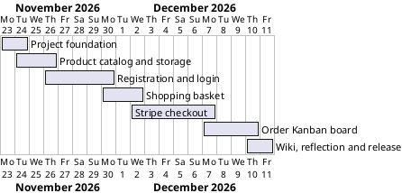

# Project Plan

## Metadata
| Key | Value |
| --- | --- |
| ID | PP-001 |
| CrossReference | [BC-001], [SA-001], [MIL-001], [MIL-002], [MIL-003], [MIL-004], [MIL-005], [MIL-006], [MIL-007] |
| Language | en |
| Domain | it |

## Version History
| Date | Status | Author | Reviewer | Change | Commit |
| --- | --- | --- | --- | --- | --- |
| 2026-11-22 | Deprecated | Jens Tirsvad Nielsen | S01 | Initial version | pending |
| 2026-11-22 | Accepted | Jens Tirsvad Nielsen | S01 | Accepted after review RC-003; stand-in review, not independent | pending |

---

## Purpose

This plan schedules the seven build steps of the online shop over the Business
Case constraint: finish by 2026-12-11. Each step is one gateway, one branch and
one pull request, and each ends with a screenshot and wiki pages.

## Planning Assumptions

- Week 1 starts 2026-11-23; the plan ends by 2026-12-11, per [BC-001].
- Phase length: one to five days; the pace follows the communication cadence in [SA-001].
- Branches are named for the milestone, for example `mil-001-foundation`, and each pull request closes its issues.
- The PO language is English and the domain is IT; the wiki adds Danish and Bahasa Malaysia.

## Gateway Schedule

| Gateway | Document | Window | Decision date | Owner | Stories | Main deliverable | Milestone |
| --- | --- | --- | --- | --- | --- | --- | --- |
| Project foundation | [MIL-001] | 2026-11-23 to 2026-11-24 | 2026-11-24 | S01 | none | Tooling, README, skeleton, first page | |
| Product catalog and storage | [MIL-002] | 2026-11-24 to 2026-11-26 | 2026-11-26 | S01 | none | Products, SQLite, catalog pages | |
| Registration and login | [MIL-003] | 2026-11-26 to 2026-11-30 | 2026-11-30 | S01 | none | Accounts, sessions, CSRF, admin role | |
| Shopping basket | [MIL-004] | 2026-11-30 to 2026-12-02 | 2026-12-02 | S01 | none | Basket with totals | |
| Stripe checkout | [MIL-005] | 2026-12-02 to 2026-12-07 | 2026-12-07 | S01 | none | Sandbox payment and paid orders | |
| Order Kanban board | [MIL-006] | 2026-12-07 to 2026-12-10 | 2026-12-10 | S01 | none | Admin board with drag and drop | |
| Wiki, reflection and release | [MIL-007] | 2026-12-10 to 2026-12-11 | 2026-12-11 | S01 | none | Three-language wiki, reflection, final checks | |



## Scope Coverage

| Business Case scope item | Gateway |
| --- | --- |
| Product catalog, persistent storage | [MIL-002] |
| Registration, login, logout, admin role | [MIL-003] |
| Shopping basket | [MIL-004] |
| Stripe Checkout in test mode, orders | [MIL-005] |
| Customer order history and admin order board | [MIL-006] |
| Tests, README, Doxyfile, `pyproject.toml`, `.gitignore`, opengrep, repository metadata | [MIL-001] |
| Screenshots per step | [MIL-001] to [MIL-006] |
| Wiki in three languages, reflection | [MIL-001] to [MIL-007] |

## Dependencies

```
MIL-001 → MIL-002 → MIL-003 → MIL-004 → MIL-005 → MIL-006 → MIL-007
```

A No-Go moves every later decision date by the days needed to fix and review again;
the end date of 2026-12-11 is reported as at risk in the run summary.

## Plan Risks

| Risk | Impact | Mitigation |
| --- | --- | --- |
| The Stripe sandbox cannot be reached from the signed-in Chrome tab | Payment milestone blocked | Stop and report; the gateway port and fake let other work continue |
| The Docker browser harness takes longer than planned | Screenshots late in every milestone | Build it first in [MIL-001]; stop and report if Docker is unavailable |
| Wiki translation in three languages grows | Release milestone slips | Write each step's wiki pages in the same milestone, not at the end |
| The repository host API rejects a token | Metadata or pull requests blocked | Stop and report; the token is never printed |

## Open Issues

- No Domain Dictionary (`DICT`) or Governance document exists; the vocabulary is small and every owner is S01, so neither is needed at this size.
- The PlantUML server setting in `docs/artifact-registry.md` is empty, so the Gantt chart is not rendered by the check script.
- The framework's session prompt-log folder is kept out of the repository through `.gitignore`, because the Product Owner's rule on wording applies to every artifact.
- The assignment suggests Flask; ADR-0001 chooses the standard library to keep the project free of runtime dependencies.
- The dry-run output of `sync-project.sh` is the plan the Product Owner accepts; `--apply` runs after acceptance, because the publish workflow is not installed.

---

[BC-001]: ./business-case.md
[SA-001]: ./stakeholder-analysis.md
[MIL-001]: ./milestones/mil-001-foundation.md
[MIL-002]: ./milestones/mil-002-catalog-storage.md
[MIL-003]: ./milestones/mil-003-accounts.md
[MIL-004]: ./milestones/mil-004-basket.md
[MIL-005]: ./milestones/mil-005-stripe-checkout.md
[MIL-006]: ./milestones/mil-006-order-kanban.md
[MIL-007]: ./milestones/mil-007-wiki-release.md
